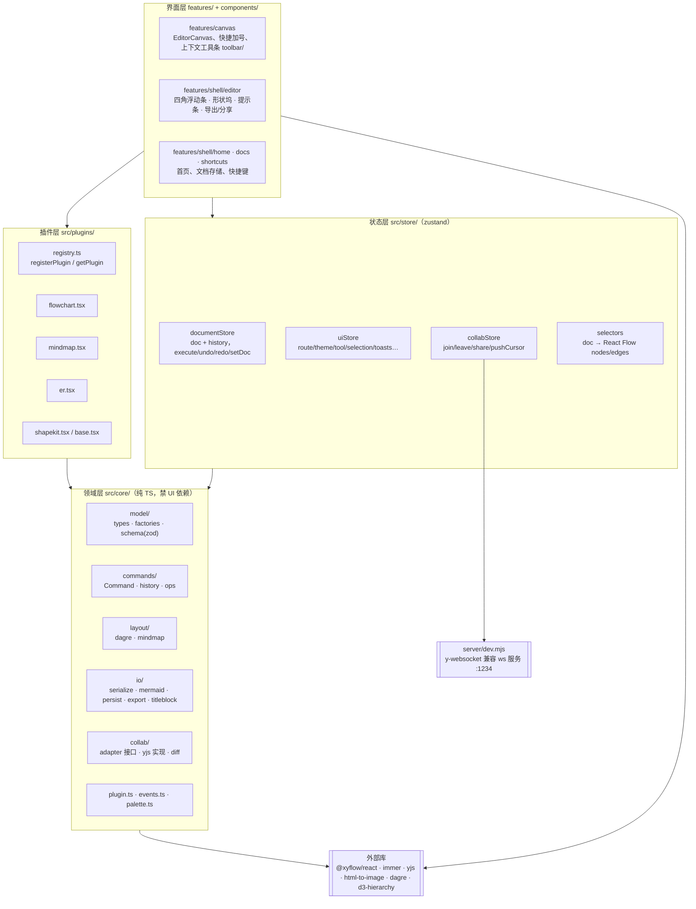
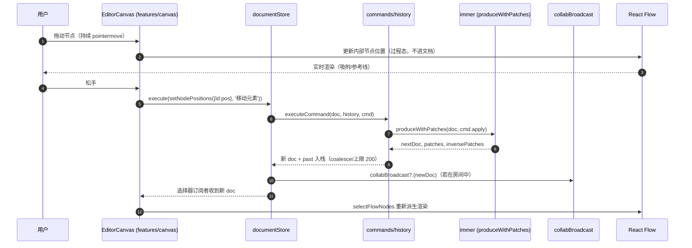
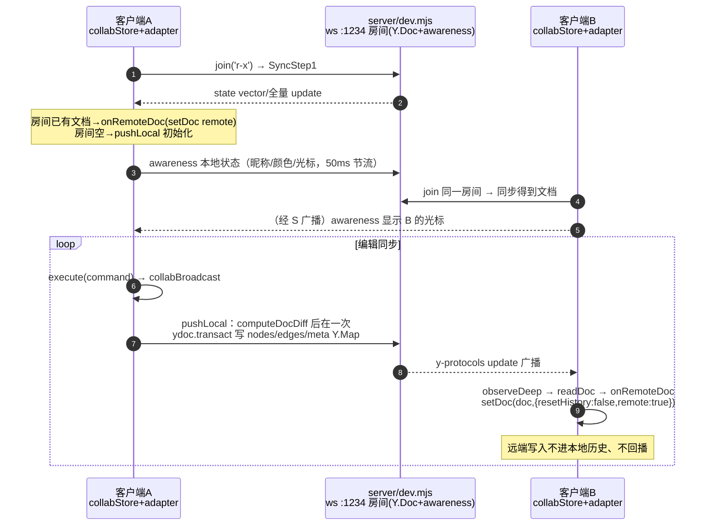
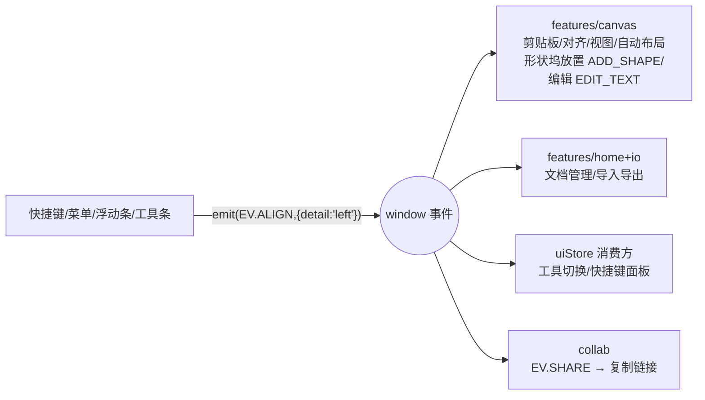

# DiagramStudio 架构设计

> 本文档对应课程交付物清单第 2 项。接口与分层以 `docs/IMPL_CONTRACT.md` 为事实来源，代码位置均在文中标注。

## 目录

- [1. 设计目标](#1-设计目标)
- [2. 分层架构](#2-分层架构)
- [3. 模块职责](#3-模块职责)
- [4. 数据模型](#4-数据模型)
- [5. 核心数据流：一次拖动如何变成可撤销的命令](#5-核心数据流一次拖动如何变成可撤销的命令)
- [6. 插件机制](#6-插件机制)
- [7. 协作架构](#7-协作架构)
- [8. 边界规则：为什么 core 禁 UI 依赖](#8-边界规则为什么-core-禁-ui-依赖)
- [9. 跨模块通信](#9-跨模块通信)
- [10. 部署形态](#10-部署形态)

## 1. 设计目标

1. **三种图共用一套引擎**：画布、工具条、历史、导入导出对图类型无感知，差异全部收敛进插件。
2. **可靠撤销重做**：文档只能通过命令修改，历史按补丁（patch）回放，而不是存快照。
3. **核心层可纯单测**：`src/core` 是纯 TypeScript，不依赖 React/zustand/@xyflow，由 ESLint `no-restricted-imports` 强制。
4. **协作可拔插**：协作经 `CollabAdapter` 接口接入，关闭或失败时产品完全正常。

## 2. 分层架构



依赖方向自上而下，`src/core` 不反向依赖任何上层；`store` 依赖 `core` 与外部库；`plugins` 依赖 `core` 契约并把渲染实现成 React 组件（`plugins/` 不在 core 的禁 React 规则内，它属于 UI 适配层）。

## 3. 模块职责

| 模块 | 路径 | 职责 | 不做什么 |
| --- | --- | --- | --- |
| model | `src/core/model/` | `DiagramDoc` 等类型（types.ts）、`createDoc/createNode/createEdge/createId`（factories.ts）、zod 校验与引用完整性（schema.ts） | 不感知渲染与 UI |
| commands | `src/core/commands/` | `Command` 契约（command.ts）、补丁历史栈（history.ts）、全部通用命令工厂与纯函数（ops.ts，配套 ops.test/ops2.test） | 不碰 DOM、不发事件 |
| layout | `src/core/layout/` | dagre 布局（dagre.ts）、思维导图左右交替布局与折叠子树集合（mindmap.ts） | 不做动画（动画是画布职责） |
| io | `src/core/io/` | JSON 序列化（serialize.ts）、localStorage 持久化（persist.ts）、Mermaid 解析/导出（mermaid.ts）、PNG/SVG 文件导出（export.ts）、图框标题栏（titleblock.ts） | 不保存 React Flow 内部状态 |
| collab | `src/core/collab/` | `CollabAdapter` 接口（adapter.ts）、yjs 实现（yjs.ts）、文档 diff 纯函数（diff.ts） | 不直接改 store（走回调） |
| plugin/events/palette | `src/core/` | `DiagramPlugin` 契约（plugin.ts）、`EV.*` 事件名常量（events.ts）、节点配色与 WCAG 工具（palette.ts） | — |
| store | `src/store/` | `documentStore`（文档唯一真相源）、`uiStore`（界面过程态）、`collabStore`（协作状态）、`selectors`（doc→React Flow 派生） | 不直接渲染 |
| plugins | `src/plugins/` | 三种图的 `DiagramPlugin` 实现（flowchart/mindmap/er.tsx）、共享 SVG 件（shapekit.tsx）、基座插件（base.tsx）、注册表（registry.ts） | 不改文档数据（经 dispatch 命令） |
| features | `src/features/` | `canvas/`：EditorCanvas 与画布交互、快捷加号、统一建节点（nodeFactory）、焦点交接（focus）、上下文工具条（toolbar/）；`shell/editor/`：四角浮动条、形状坞、提示条、导出与分享；`shell/home|docs|shortcuts|toasts`：首页、文档存储与事件、快捷键、提示条 | 不写 `type === 'x'` 分支 |
| server | `server/dev.mjs` | y-websocket 兼容 ws 服务（sync+awareness，房间存内存） | 不持久化、不鉴权 |

## 4. 数据模型

集合一律用 id 为键的 `Record`，便于 immer 生成补丁、也便于 1:1 映射到 Y.Map。

```mermaid
classDiagram
    class DiagramDoc {
        +schemaVersion: 1
        +id: string
        +title: string
        +type: DiagramType
        +nodes: Record~string,DiagramNode~
        +edges: Record~string,DiagramEdge~
        +zOrder: string[]
        +settings: {grid, snap, layoutDirection}
        +createdAt: number
        +updatedAt: number
    }
    class DiagramNode {
        +id: string
        +kind: string
        +position: {x,y}
        +size: {w,h}
        +text: string
        +style: NodeStyle
        +data: Record~string,unknown~
    }
    class DiagramEdge {
        +id: string
        +source: string
        +target: string
        +sourceHandle?: string
        +targetHandle?: string
        +routing: bezier|step|straight
        +arrowStart/arrowEnd: none|arrow
        +label?: string
        +style: EdgeStyle
        +cardinality?: {source,target}
    }
    class NodeStyle {
        +fill/stroke: palette key
        +strokeWidth/dash/fontSize/bold/align
    }

    DiagramDoc "1" *-- "n" DiagramNode : nodes
    DiagramDoc "1" *-- "n" DiagramEdge : edges
    DiagramNode ..> NodeStyle
    DiagramEdge ..> DiagramNode : source/target

    note for DiagramNode "data 由插件收窄：\nmindmap {parentId, collapsed}\ner {fields: ErField[]}"
    note for DiagramEdge "cardinality 仅 ER：\n'1'|'0..1'|'N'|'0..N'"
```

关键设计：

- `zOrder` 是节点 id 数组，靠后者在上；派生 React Flow nodes 时按它排 `zIndex`（`selectors.ts`）。
- `style.fill/stroke` 存 **palette key**（`white/teal/…` 或 `ink`），渲染时经 `resolveFill(key, theme)` 按主题解析——同一份文档在明暗主题下都正确。
- React Flow 的 `nodes/edges` **不单独存储**，由 `selectFlowNodes/selectFlowEdges(doc, plugin)` 纯函数派生，保证文档是唯一真相源。
- `plugin.hiddenNodeIds?(doc)`（思维导图折叠子树）在选择器层过滤，UI 不判断图类型。

## 5. 核心数据流：一次拖动如何变成可撤销的命令

原则：**拖动过程态不进文档**。拖动/缩放期间只改 React Flow 内部态，松手才提交一条命令——因此「拖一次」永远是历史上的一条，可整体撤销。



撤销/重做：`undo` 把栈顶 `inversePatches` 经 `applyPatches` 回放；`redo` 回放 `patches`。`coalesceKey` 相同且间隔 <600ms 的命令合并（如连续打字，label 保留首条）；无实质改动的命令不入栈；栈上限 200 条。

## 6. 插件机制

策略模式：`DiagramPlugin` 接口（`src/core/plugin.ts`）把三种图的差异收敛为「数据 + 行为」的声明。

```mermaid
flowchart LR
    subgraph ENG["引擎（对图类型无感知）"]
        CV2[EditorCanvas]
        INSP[Inspector]
        HIST[History]
        IO2[Import/Export]
    end

    subgraph PIF["DiagramPlugin 接口"]
        direction TB
        shapes["shapes: ShapeDef[]<br/>kind/name/defaultSize/render"]
        edge["edgeDefaults"]
        layout["layout(doc, opts)"]
        keymap["keymap?: Tab/Enter → Command"]
        hooks["onDropOnNode?<br/>autoLayoutOnChange?<br/>hiddenNodeIds?<br/>edgeFields?: 'cardinality'"]
        tpl["templates: DiagramDoc[]"]
    end

    subgraph IMPL["三个插件 src/plugins/"]
        FC["flowchart.tsx<br/>10 个 ShapeDef + dagre<br/>+ 登录流程模板"]
        MM["mindmap.tsx<br/>centerTopic/topic<br/>Tab/Enter/折叠/改父级<br/>autoLayoutOnChange"]
        ER["er.tsx<br/>entity/weakEntity<br/>字段行内编辑<br/>edgeFields=cardinality"]
    end

    ENG --> PIF
    FC & MM & ER -.实现.-> PIF
    REG[registry.ts<br/>getPlugin(type)] --> IMPL
```

要点：

- `ShapeDef.render(node, ctx)` 返回渲染结果；core 用泛型 `R` 隔离类型，`plugins/` 以 `R=ReactNode` 实例化——契约在 core、渲染在插件。`ctx.dispatch` 是形状行内编辑（ER 字段、折叠圆钮）提交命令的唯一通道。
- 画布/工具条查能力位而非判断类型：连线工具条靠 `plugin.edgeFields === 'cardinality'` 决定显示 ER 基数；单选工具条渲染 `plugin.nodeActions`；形状坞点击先问 `plugin.placeFromPalette`；思维导图 `autoLayoutOnChange=true` 使画布在文档变化后自动重排。
- `templates` 挂在插件上，首页/空画布经 `getPlugin(type).templates` 取模板，不出现图类型分支。

## 7. 协作架构



组件对应：

| 件 | 位置 | 职责 |
| --- | --- | --- |
| `CollabAdapter` | `src/core/collab/adapter.ts` | 接口：join/pushLocal/pushCursor/leave + CollabCallbacks（onRemoteDoc/onPeers/onStatus） |
| `YjsCollabAdapter` | `src/core/collab/yjs.ts` | nodes/edges/meta 三个 Y.Map；`observeDeep` 回填；awareness 昵称/颜色/光标（50ms 节流）；`applyingRemote` 防回声 |
| `computeDocDiff` | `src/core/collab/diff.ts` | 本地 doc 与 Y.Doc 读回值的差异（set/del/metaChanged），纯函数 |
| `collabStore` | `src/store/collabStore.ts` | join/leave/share/initFromUrl（?room=）/pushCursor；`setCollabBroadcast` 解耦 documentStore |
| `server/dev.mjs` | `server/dev.mjs` | y-websocket 协议精简实现：MESSAGE_SYNC/MESSAGE_AWARENESS、rooms 内存驻留 |

协作中的撤销：本地撤销=对当前文档应用本地逆补丁，**不进远端历史**；若逆补丁指向的元素已被他人删除，`applyPatches` 自然跳过（immer 对不存在路径的 replace 不生效），文档保持一致——这是已声明的已知限制。

## 8. 边界规则：为什么 core 禁 UI 依赖

`eslint.config.js` 对 `src/core/**/*.ts` 启用 `no-restricted-imports`：

| 禁止 import | 原因 |
| --- | --- |
| `react` / `react-dom` | core 必须保持纯 TypeScript，可被 vitest 在 jsdom 外单测 |
| `zustand` | 状态管理只允许出现在 `src/store` |
| `@xyflow/*` | 画布细节只允许出现在 `features/canvas` |
| `html-to-image` | DOM 截图只允许出现在 `features/io` |
| `*/store/*`、`@/store/*` | core 不得反向依赖 store |

收益：

1. **可测**：命令、历史、布局、解析、diff 都是纯函数，上百个单测数秒内跑完，不启浏览器。
2. **可换**：画布换成别的库、协作换成别的协议时 core 不动（`CollabAdapter`/`ShapeDef<R>` 泛型已经把 React/yjs 类型挡在边界外）。
3. **可控**：core 对 UI 零了解，`EV.*` 事件名也是纯字符串常量（`events.ts` 不引 DOM），发不发事件由 features 决定。

> 边界执行案例：`export.ts` 初版放在 `core/io` 直接 import `html-to-image`，lint 立即报错——已按规则上移到 `src/io/export.ts`（DOM 边界单列），core 只保留文本类导出。规则是有牙齿的。

## 9. 跨模块通信

为切断「快捷键总线→各 feature」的直接引用，模块间用 `window` CustomEvent 解耦（`src/core/events.ts` 只定义字符串常量）：



所有权表（IMPL_CONTRACT §5）：canvas 消费 `SELECT_ALL/COPY/…/ALIGN/DISTRIBUTE/AUTO_LAYOUT/FIT/ZOOM_*`，以及改版新增的 `ADD_SHAPE`（形状坞点击，画布按视口中心放置）与 `EDIT_TEXT`（工具条/右键「编辑文字」）；home/io 消费 `NEW_DOC/OPEN_DOC/…/SAVE/EXPORT_*/IMPORT_*`；collab 消费 `SHARE`。

## 10. 部署形态

- **单机（默认）**：`pnpm install && pnpm dev` → Vite :5173。全部资源本地打包（字体 @fontsource-variable/inter、图标 lucide），离线可用；文档存 localStorage（`ds.docs.v1` + `ds.docIndex.v1`）。
- **协作**：`pnpm dev:collab` 起 `server/dev.mjs`（ws :1234，`DS_COLLAB_PORT`/`VITE_COLLAB_WS` 可覆盖）+ Vite。房间存内存、无鉴权，定位为同机/内网演示。
- **构建**：`pnpm build`（tsc -b + vite build）→ `dist/` 静态站。
- **在线部署**：GitHub Pages（<https://aqua196.github.io/diagramstudio/>）。推送 main 触发 `.github/workflows/pages.yml`：lint → typecheck → 单测 → `pnpm build:pages`（`DS_BASE=/diagramstudio/` 子路径）→ 把 `dist/` 推到 `gh-pages` 分支。纯静态，无后端；协作服务不随站点部署。
