# 前端改版说明：画布优先（2026-10-21）

> 本文记录 UI 改版的动机、设计原则、改动清单与验证结果。改版只动「界面层 + 插件可选钩子」，`src/core` 的模型、命令、历史、布局、IO、协作没有改语义；SPEC §6 的界面描述以本文为准。

## 目录

- [1. 为什么要改：第一次打开时的问题](#1-为什么要改第一次打开时的问题)
- [2. 设计原则](#2-设计原则)
- [3. 布局前后对比](#3-布局前后对比)
- [4. 改动清单](#4-改动清单)
- [5. 截图对比](#5-截图对比)
- [6. 工程约束如何保持](#6-工程约束如何保持)
- [7. 验证](#7-验证)
- [8. 没做的与后续](#8-没做的与后续)

## 1. 为什么要改：第一次打开时的问题

以「第一次用的同学」身份走一遍旧界面，问题集中在**信息太多、入口太隐蔽、有几处会误导**：

| # | 现象 | 后果 |
| --- | --- | --- |
| P1 | 同屏常驻：48px 顶栏 13 个控件 + 左 240px 形状库 + 右 280px 检查器 + 小地图 + 两层方格线 | 1440 宽屏上画布只剩约 64%，视觉噪声大，第一眼不知道从哪下手 |
| P2 | 检查器分组默认折叠；未选中时右栏 280px 只有一行「画布设置」 | 选中节点后看到三个折叠标题，还要再点一次才有属性；一大块空白 |
| P3 | 顶栏「流程图 / 思维导图 / ER 图」分段控件长得像标签页，实际会**把当前文档改成另一种类型** | 误点后节点退化成兜底方框，看起来像「图坏了」 |
| P4 | 空画布提示「双击画布放一个节点」，但 React Flow 默认双击缩放 | 双击只会放大到 200%，提示与行为不符 |
| P5 | 添加节点只能「从左侧拖」；连线要精确拖到 8px 圆点 | 新手不知道要拖；画一条三步流程要十几次精确拖拽 |
| P6 | 思维导图 Tab 加子主题后选中仍停在父节点；空白导图连中心主题都没有 | 键盘建树要不停双击改字；空白导图无从下手 |
| P7 | 空文档放下第一个节点会被初始 fitView 拽到画面正中 | 第二个落点和第一个叠在一起 |
| P8 | 首页思维导图缩略图错乱（模板坐标是占位，未布局就缩画） | 首页第一印象差 |
| P9 | 点「新建」后不画直接返回，首页留下一张空白「未命名图表」 | 文档列表被空文档污染 |
| P10 | 流程图模板两条回环曲线交叉、标签压线；ER 模板两条关系挤在同一点出线 | 演示用的示例图本身不够整洁 |

## 2. 设计原则

1. **画布优先**：画布铺满全屏，所有界面都是悬浮在四角的小卡片，不再切走画布宽度。
2. **渐进披露**：常驻界面只留高频操作；属性跟着选中对象出现在它旁边（上下文工具条），低频项收进「更多」。
3. **就地操作**：改颜色、加子主题、改基数都在被选中的元素旁边完成，不用把视线挪到屏幕另一侧。
4. **一步到位**：任何「添加节点」的动作完成后，新节点自动选中并进入文字编辑——加完直接打字。
5. **界面即教程**：底部提示条按「图类型 × 有无选中」给 2–3 条可操作提示，可一键关闭并记住。
6. **不破坏架构**：差异仍然只进插件（新增的都是可选钩子），引擎不判断图类型。

## 3. 布局前后对比

改版前：

```text
┌──────────────────────────────────────────────────────────────────┐
│ 顶栏：产品名·文档名 │ 图类型分段 │ 撤销重做 │ 缩放 │ 主题 │ 导出/导入 │ 更多 │
├──────────┬───────────────────────────────────────────┬───────────┤
│ 形状库    │                方格纸画布                  │ 检查器     │
│ 240px    │                                           │ 280px     │
└──────────┴───────────────────────────────────────────┴───────────┘
```

改版后：

```text
┌──────────────────────────────────────────────────────────────────┐
│ [‹ 标 文档名 · 类型 · 已保存]                    [头像][分享][导出][⋯] │
│ ┌─┐                                                              │
│ │↖│            ┌────────────────────────┐                       │
│ │✋│            │ ● T B ✎ │ ⋯ 🗑 │  ← 选中才出现的上下文工具条       │
│ │▭│            └────────────────────────┘                       │
│ │◇│                  [+] ┌──────┐ [+]   ← 四周「+」一键接下一步     │
│ │⬭│                      │ 节点 │                                 │
│ │…│                      └──────┘                                 │
│ └─┘                         [+]                                  │
│ [↶ ↷ │ − 100% + ⤢]   💡 点节点四周的 + 一键接下一步 · …  ✕   [▣ ⚙ ?] │
└──────────────────────────────────────────────────────────────────┘
```

## 4. 改动清单

### 4.1 视觉系统（`src/styles/tokens.css`、`src/core/palette.ts`）

- 新令牌：暖白画布 `--canvas` + 白色浮动表面 `--surface` + 靛蓝强调 `--accent`（亮 #5B5BD6 / 暗 #8B8DFF）；暗色改为中性炭灰。
- 节点配色：7 色底色重调为柔和色，并新增**同色相描边** `NODE_STROKES`；默认描边 `ink` 跟随底色取同色相描边（旧文档无需迁移）。
- 点阵网格替代两层方格线；导出「点阵」背景与画布一致。
- 字体 Inter（本地打包，离线可用）+ 中文系统字体；阴影/圆角/动效统一成三档令牌。
- 对比度单测扩充：强调色作为面板上的文字/图标 ≥4.5:1；同色相描边与底色 ≥1.8:1。

### 4.2 首页（`features/shell/home/`）

- 欢迎语 + 三张新建卡：上半部是该类型示例的**真实缩略图**（按形状/配色缩画，思维导图先布局再画，修复 P8），下半部「新建空白 / 看示例」两个入口。
- 「最近的图表」改为缩略图网格，显示类型徽标与相对时间（刚刚 / N 分钟前 …）。

### 4.3 编辑器外壳（`features/shell/editor/`）

| 位置 | 内容 |
| --- | --- |
| 左上 | 返回首页 + 品牌标；可点改名的文档名；类型与「已自动保存」 |
| 右上 | 在线头像 · 分享（弹层：说明 → 一键开启 → 链接/状态/成员/结束）· 导出（主按钮）· 更多（导入、主题、快捷键、返回首页） |
| 左侧 | 形状坞：选择/抓手 · 常用形状（**点击即添加**，也可拖）· 更多形状 · 示例模板 · 自动整理 |
| 左下 | 撤销/重做（提示里带操作名）· 缩放组 |
| 右下 | 小地图开关（默认关）· 画布设置（网格/吸附/整理方向）· 快捷键 |
| 底部居中 | 上手提示条（插件 `tips`） |

- 删除「切换图类型」分段控件（修复 P3）：类型在新建时决定。
- 导出合并为一个对话框：PNG / SVG / JSON / Mermaid 四张格式卡片，图片格式再选清晰度、背景、图框标题栏。

### 4.4 上下文工具条（`features/canvas/toolbar/`，取代检查器，修复 P2）

| 选中 | 工具条 |
| --- | --- |
| 单个节点 | 颜色 · 字号 · 加粗 · 编辑文字 · 插件动作（思维导图「加子主题/加同级」、ER「添加字段」）· 更多（位置尺寸、边框粗细、虚线边框、层级、副本）· 删除 |
| 多个节点 | 计数 · 统一颜色（一条历史）· 六向对齐 · 横/纵等距 · 删除 |
| 一条连线 | 曲线/折线/直线 · 终点箭头 · 虚线 · 标注 · ER 两端基数 · 删除 |

工具条用 React Flow 的 `NodeToolbar` / `EdgeToolbar`：屏幕空间、不随缩放变形、拖动时自动隐藏。

### 4.5 上手交互（修复 P4–P7、P9）

- **点形状即添加**：形状坞点击 → 放到视口中心（与已有节点重叠时沿对角线错开）→ 选中并进入编辑。
- **四周「+」**：选中单个节点时四周出现「+」，点一下在该方向接一个相连的新节点（流程图「开始/判断」之后自动接「处理」），已连线的一侧不显示；随后直接打字。
- **双击空白**真正放节点（关闭 React Flow 双击缩放）。
- **思维导图**：空白导图自带中心主题；Tab/Enter 新建的主题自动选中并进入编辑——「Tab → 打字 → Enter → Enter → 打字」一路键盘建树；折叠钮放在分支外侧、展开态悬停才出现、收起态显示子节点数。
- **ER**：新实体预置 `id` 主键；新关系默认 1 对 0..N；关系线与实体高度对齐修正。
- **适应画面**只在打开/切换文档时做，空文档放第一个节点不再被拽走。
- **没动过的空白文档**离开时自动回收（`features/shell/docs/pristine.ts`）。
- 右键菜单带图标与快捷键；空白处右键提供全选、适应画面。
- 示例重排（修复 P10）：流程图主链居中、失败支路在左、回环走外侧且全部折线；ER 关系线全部横平竖直。

### 4.6 插件契约新增的可选钩子（`src/core/plugin.ts`）

| 钩子 | 用途 | 实现者 |
| --- | --- | --- |
| `ShapeDef.icon` / `defaultData` / `paletteHidden` | 形状坞图标；新建时的私有数据；不进形状坞 | 三个插件；ER 预置主键；思维导图隐藏中心主题 |
| `nodeActions` | 单选工具条上的专属动作 | 思维导图加子/加同级；ER 加字段 |
| `placeFromPalette` | 形状坞点击时由插件决定放置 | 思维导图挂到所选主题（或根）下 |
| `quickAddSides` / `nextKind` | 四周「+」的方向与新节点形状 | 思维导图关闭；流程图起止/判断后接处理 |
| `createBlank` | 空白文档初始内容 | 思维导图预置中心主题 |
| `tips` | 提示条文案 | 三个插件 |
| `edgeDefaults.cardinality` | 新连线默认基数 | ER |

## 5. 截图对比

由 `e2e/visual.spec.ts` 生成：改版前取自 `main`（`docs/screenshots/redesign/before/`），改版后为当前分支（`docs/screenshots/redesign/after/`）。

| 场景 | 改版前 | 改版后 |
| --- | --- | --- |
| 首页 | 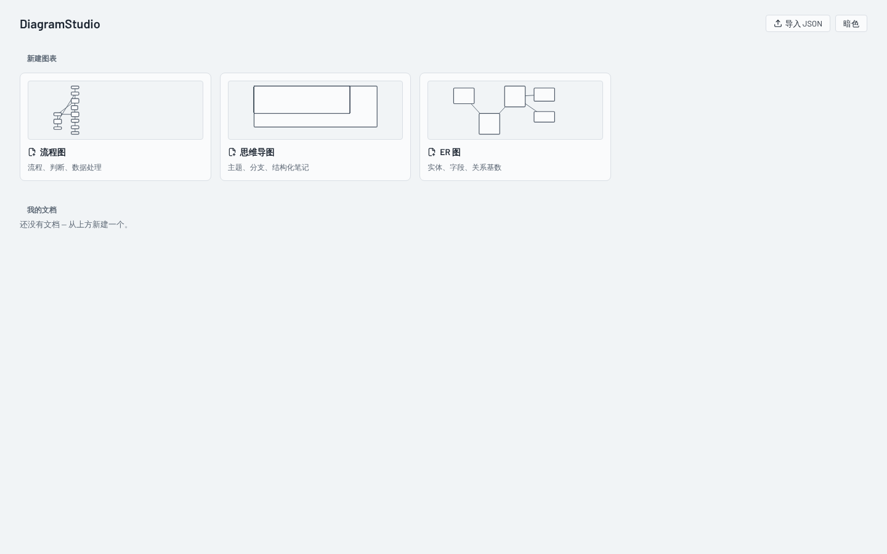 | 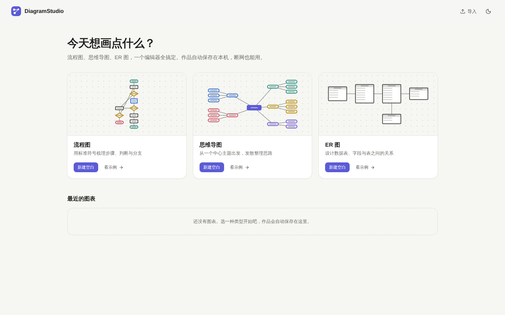 |
| 空白编辑器 | 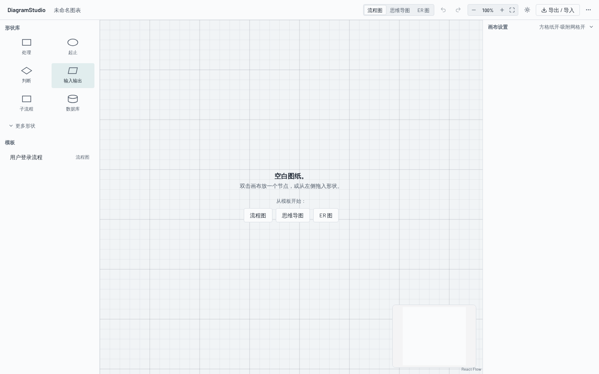 | 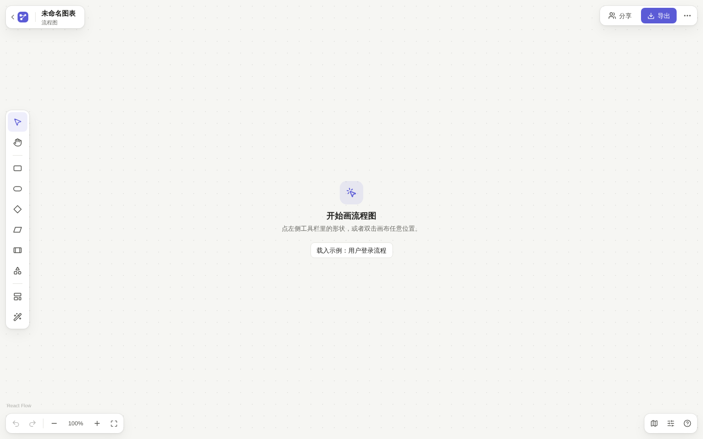 |
| 流程图示例 | 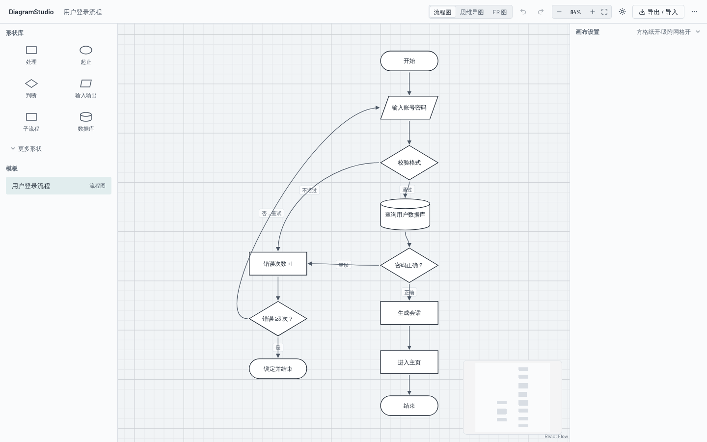 | 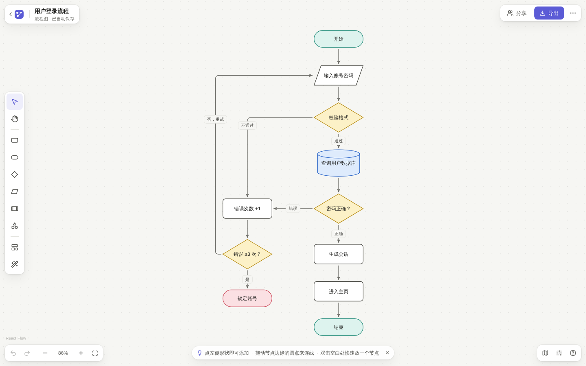 |
| 思维导图示例 | 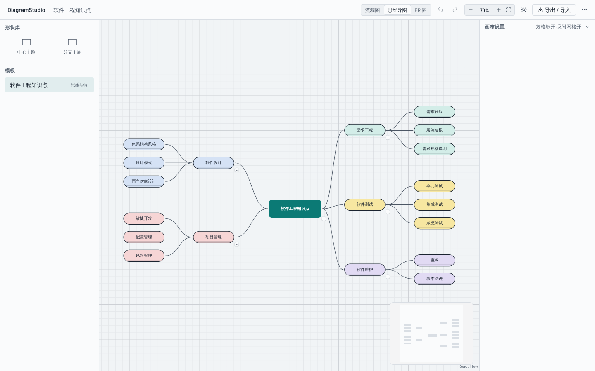 | 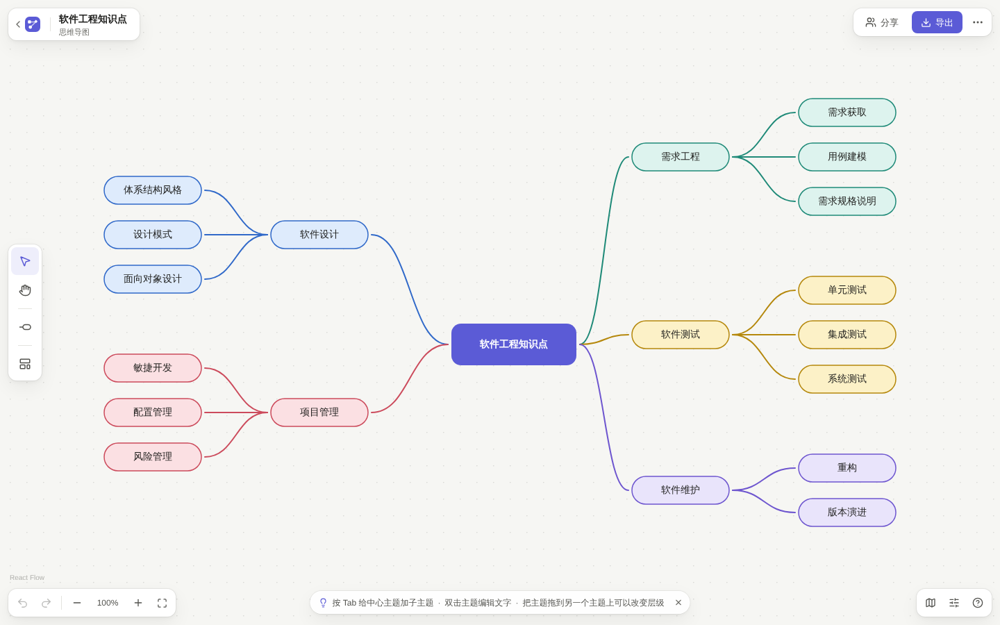 |
| ER 示例 | 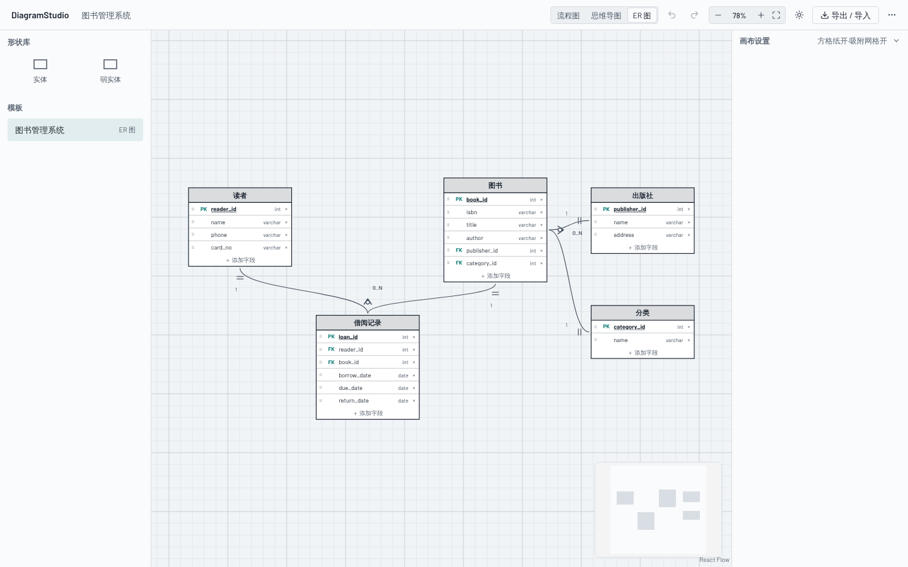 | 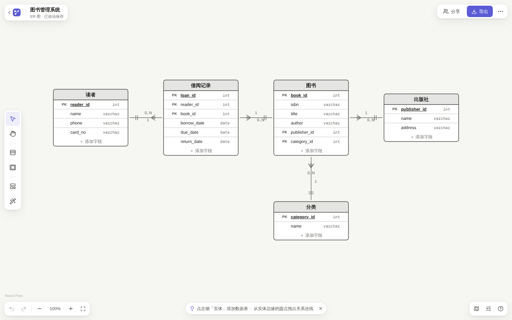 |
| 选中节点 | 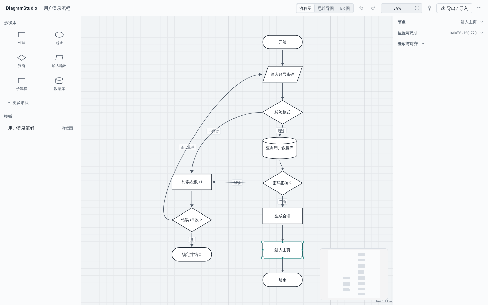 | 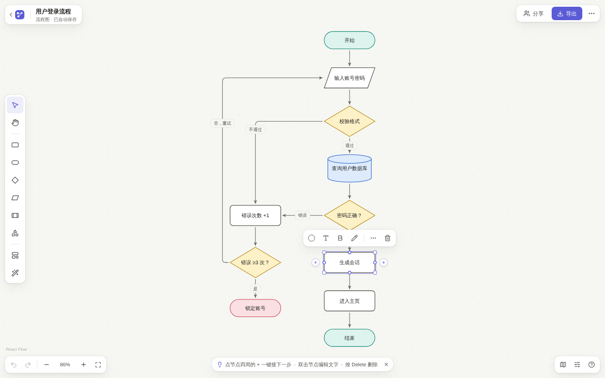 |
| 深色 | 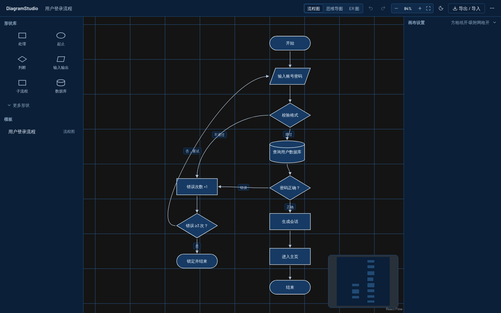 | 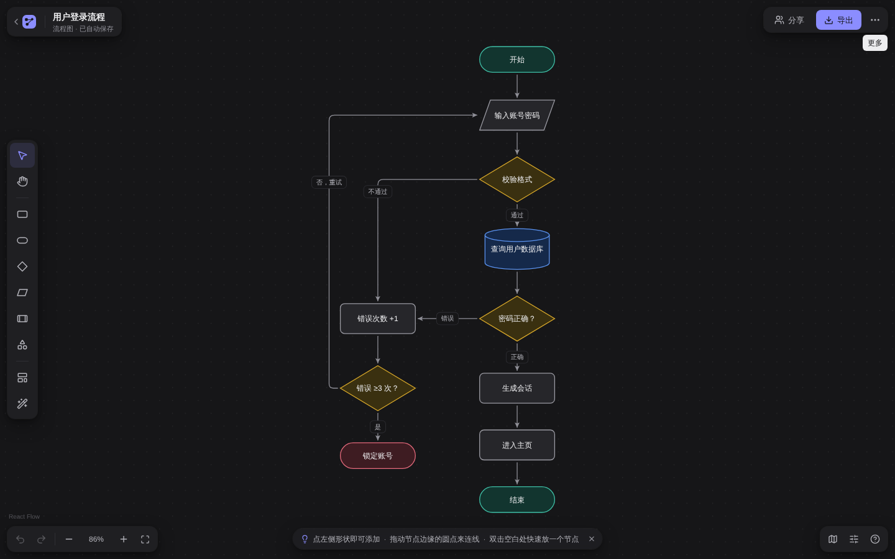 |

## 6. 工程约束如何保持

- `src/core` 仍禁引 UI 依赖（ESLint 强制）；改版只在 `palette.ts`（新增描边表）与 `plugin.ts`（可选钩子）、`importer.ts`（可注入路由）做向后兼容的增补。
- 引擎不判断图类型：工具条用 `plugin.edgeFields` / `plugin.nodeActions`，形状坞用 `paletteHidden` / `placeFromPalette`，提示条用 `plugin.tips`。
- 所有文案仍在 `src/i18n/zh.ts`（新增 `editor` / `toolbar` / `exportDialog` 命名空间，`fmt()` 填占位符）；颜色仍只走令牌。
- 所有新增组件 ≤200 行；所有修改仍走命令，多选改色等批量操作是**一条**历史。

## 7. 验证

- 单元测试 104 → 125：新增快捷添加（方向/形状/避让/已连线侧）、统一建节点与连线、焦点交接、多选改色撤销、插件钩子、空白文档回收、相对时间、Mermaid 路由注入、对比度。
- e2e 全部按新界面重写（共用 `e2e/helpers.ts`），新增「形状坞点击 → 打字 → 快捷加号」「双击空白放节点」「空白文档回收」；手册配图改由 `e2e/guide.spec.ts` 一键重生成。
- 无障碍：axe 首页 + 编辑器（亮/暗）零违规。
- 性能：发现旧性能测试测的是无头浏览器帧时钟而非应用开销，改用 CDP Trace 测主线程任务；改版版本在 500 节点拖拽上主线程忙碌时间比改版前少约 20%（局部视口）和约 65%（全览），见 `docs/PERFORMANCE.md`。

## 8. 没做的与后续

- 移动端/触屏：仍是桌面优先（<1024px 提示加宽窗口）。
- 连线吸附到 ER 具体字段行、节点内富文本：超出本次范围。
- 全览（500 节点全可见）拖拽仍约 137ms 主线程/步，受 React Flow 受控模式下每帧全量 `adoptUserNodes` 所限，见性能报告「已知边界」。
