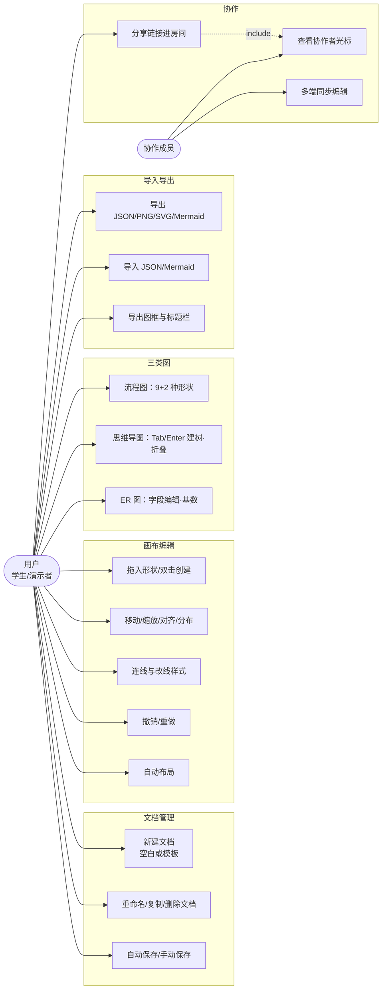

# DiagramStudio 需求分析

> 本文档对应课程交付物清单第 1 项。功能口径以 `docs/SPEC.md` §3/§5 与 `docs/IMPL_CONTRACT.md` 为准。

## 目录

- [1. 项目背景](#1-项目背景)
- [2. 用户角色](#2-用户角色)
- [3. 用户故事](#3-用户故事)
- [4. 用例模型](#4-用例模型)
- [5. 功能需求](#5-功能需求)
- [6. 非功能需求](#6-非功能需求)
- [7. 约束与边界](#7-约束与边界)

## 1. 项目背景

DiagramStudio 是一个纯前端的在线图表编辑器，覆盖软件工程教学中最常用的三类图：**流程图、思维导图、ER 图**。定位是「制图室」：方格纸画布、针管笔线条、CAD 风格的方形夹点，强调精确与工具感。安装依赖后完全离线运行，所有文档保存在浏览器 localStorage；可选的实时协作由本机 `y-websocket` 兼容服务提供。

项目的工程目标与产品目标同等重要：通过插件化架构让三种图共享同一套编辑引擎，通过「命令 + 补丁」历史实现可靠的撤销重做，通过 ESLint 边界规则保证核心层可纯单测。

## 2. 用户角色

| 角色 | 描述 | 核心诉求 |
| --- | --- | --- |
| 学生/课程用户（主要） | 绘制作业中的流程图、ER 图、复习用思维导图 | 上手快、形状齐全、导出可用于报告 |
| 教师/演示者 | 课堂现场演示软件功能 | 操作路径短、演示效果稳定、快捷键高效 |
| 协作小组成员 | 两人同时编辑同一文档 | 看到对方光标与改动，不需要注册登录 |

三类角色共用同一套界面，无权限分级；协作是「链接即房间」的轻量模式。

## 3. 用户故事

- 作为学生，我希望从形状库拖一个「判断」菱形到画布并连线，以便 5 分钟内画出作业流程图。
- 作为学生，我希望撤销时能直接看到「撤销：移动 3 个元素」，以便知道这一步会退回什么。
- 作为学生，我希望导出带工程图框与标题栏（图名/作者/日期/版本）的 PNG，以便直接贴进课程报告。
- 作为学生，我希望把已有的 Mermaid 代码导入成可继续编辑的流程图，以便复用旧材料。
- 作为演示者，我希望全程只用快捷键（Tab 建树、Shift+L 自动布局、? 查快捷键），以便演示流畅。
- 作为小组成员，我希望复制一条链接发给同伴就能共同编辑并看到对方光标，以便零成本协作。
- 作为离线用户，我希望断网时所有功能依然可用，以便在教室/图书馆环境不受网络影响。

## 4. 用例模型

主要参与者（Actor）即 §2 的角色，用例按功能域分组：

关键用例说明：

| 用例 | 前置条件 | 主流程 | 异常流 |
| --- | --- | --- | --- |
| 连线 | 画布至少两个节点 | 悬停节点出现四个连接点 → 拖出 → 落到目标节点 | 落到空白处：弹形状菜单，新建节点并自动连好 |
| 撤销 | 历史上栈非空 | 点撤销或 Ctrl+Z → 逆补丁回放 | 栈空：按钮禁用；协作中目标元素被他人删除则跳过该补丁 |
| 导入 JSON | 有 .json 文件 | 选择文件 → zod 校验 → 打开 | 校验失败：toast 给出具体中文原因（字段路径+期望类型） |
| 导入 Mermaid | 有符合子集的文本 | 粘贴文本 → 手写解析器 → dagre 摆位 → 打开 | 不认识的行跳过，完成后提示跳过了几行 |
| 分享协作 | 已启动 dev:collab | 点「分享」→ 复制 ?room= 链接 → 成员打开即进房 | 服务未启动：状态显示 connecting/offline，单机功能不受影响 |

## 5. 功能需求

编号规则：FR-域-序号。「实现口径」列对应 SPEC §5 的验收标准；优先级 P0=必须，P1=增强。

### 5.1 画布（Canvas）

| 编号 | 需求 | 实现口径 |
| --- | --- | --- |
| FR-CV-01 | 平移 | 空格+拖动、中键拖动、触控板双指；工具切换 V（选择）/H（抓手） |
| FR-CV-02 | 缩放 | Ctrl/Cmd+滚轮、按钮、适应画面；范围 10%–400% |
| FR-CV-03 | 方格纸背景 | 细格 24px，每 5 格一条粗线；可开关 |
| FR-CV-04 | 网格吸附 | 默认开，步长 12px |
| FR-CV-05 | 对齐参考线 | 拖动时吸附到其他节点的边缘和中心，显示参考线 |
| FR-CV-06 | 小地图 | 可开关 |

### 5.2 选择与编辑（Editing）

| 编号 | 需求 | 实现口径 |
| --- | --- | --- |
| FR-ED-01 | 选择 | 单击、Shift 多选、框选 |
| FR-ED-02 | 移动/缩放 | 八方向缩放，有最小尺寸；方向键微调 1px，Shift+方向键 10px |
| FR-ED-03 | 文字编辑 | 双击或 Enter 进入，Shift+Enter 换行，Esc 取消，点空白提交 |
| FR-ED-04 | 剪贴板 | 复制/剪切/粘贴（保留所选节点间连线，偏移 24px）、创建副本、删除 |
| FR-ED-05 | 叠放 | 置于顶层/底层；`[` `]` 快捷键 |
| FR-ED-06 | 对齐/分布 | 左中右上中下对齐；横向/纵向等距分布（≥3 个） |
| FR-ED-07 | 右键菜单 | 菜单项随当前选中对象变化 |

### 5.3 连线（Edges）

| 编号 | 需求 | 实现口径 |
| --- | --- | --- |
| FR-EG-01 | 创建连线 | 悬停节点出现四个连接点，拖出即连 |
| FR-EG-02 | 落空建新 | 拖到空白松手，弹形状菜单并自动连好 |
| FR-EG-03 | 线型 | 直线/折线/曲线；虚线；颜色 |
| FR-EG-04 | 箭头 | 起止箭头可选 |
| FR-EG-05 | 标签 | 双击连线加标签 |
| FR-EG-06 | 重连 | 拖动端点可改接到别的节点/连接点 |

### 5.4 三种图类型（Plugins）

| 编号 | 需求 | 实现口径 |
| --- | --- | --- |
| FR-PL-01 | 流程图形状 | 起止、处理、判断、输入输出、子流程、数据库、文档、连接符、便签共 9 类（实现含双圈起止变体，见 `src/plugins/flowchart.tsx`），全部 SVG 绘制 |
| FR-PL-02 | 思维导图 | 中心主题；Tab 加子节点、Enter 加同级、Delete 删子树；圆点折叠/展开；每次变动自动布局（左右展开）；分支自动配色；拖到另一节点上改父级（防环） |
| FR-PL-03 | ER 图 | 实体=表格式节点（字段：名称/类型/PK/FK），行内增删改字段并拖动排序；关系线两端基数（1、0..1、N、0..N）绘制为鸟脚符号或文字标注 |
| FR-PL-04 | 插件化 | 画布/检查器/历史/导入导出不得出现 `type === 'mindmap'` 分支，差异只进插件（`DiagramPlugin` 接口） |

### 5.5 自动布局（Layout）

| 编号 | 需求 | 实现口径 |
| --- | --- | --- |
| FR-LY-01 | 一键布局 | 工具栏触发，方向 TB/LR 可选 |
| FR-LY-02 | 可撤销 | 布局是一条命令，300ms 过渡动画 |
| FR-LY-03 | 分图实现 | 流程图/ER 用 dagre；思维导图用 d3-hierarchy 左右交替 |

### 5.6 文档管理与导入导出（IO）

| 编号 | 需求 | 实现口径 |
| --- | --- | --- |
| FR-IO-01 | 首页 | 文档卡片网格（模型直接画缩略 SVG）；新建/重命名/副本/删除（带确认） |
| FR-IO-02 | 模板 | 三个真实模板：「用户登录流程」「软件工程知识点」「图书管理系统」；当前实现内置「登录流程」「项目规划」「选课系统」三个模板（见各插件 `templates`） |
| FR-IO-03 | 自动保存 | localStorage，防抖 500ms；顶栏显示「已自动保存 HH:MM」；Ctrl/Cmd+S 立即保存 |
| FR-IO-04 | 导出 JSON | `docToJson` 序列化 |
| FR-IO-05 | 导入 JSON | zod 校验 + 引用完整性检查，错误给具体中文原因 |
| FR-IO-06 | 导出 PNG | 1x/2x/3x；白底/透明/方格纸背景可选 |
| FR-IO-07 | 导出 SVG | 可选「图框与标题栏」：边框+右下角工程制图标题栏（图名/作者/日期/版本/比例） |
| FR-IO-08 | Mermaid | 流程图子集导入与导出；手写解析器；不认识的行跳过并提示行数；支持链式 `A --> B --> C`、`-- 文字 -->`、虚线/粗线/双箭头 |

### 5.7 快捷键（Shortcuts）

| 编号 | 需求 | 实现口径 |
| --- | --- | --- |
| FR-SC-01 | 工具 | V 选择、H 抓手 |
| FR-SC-02 | 编辑 | Ctrl+A 全选、C/X/V/D（副本）、Delete |
| FR-SC-03 | 历史 | Ctrl+Z 撤销、Ctrl+Shift+Z 或 Ctrl+Y 重做 |
| FR-SC-04 | 视图 | Ctrl+0 适应、Ctrl+± 缩放、`[` `]` 调叠放 |
| FR-SC-05 | 其他 | Shift+L 自动布局、? 快捷键列表、Esc 取消选择；Mac 上 Ctrl 对应 Cmd |

### 5.8 协作（Collab）

| 编号 | 需求 | 实现口径 |
| --- | --- | --- |
| FR-CL-01 | 房间 | `?room=xxx` URL 参数决定房间；`pnpm dev:collab` 起本机服务 |
| FR-CL-02 | 文档同步 | nodes/edges 各一个 Y.Map，本地命令差异在一次 Yjs 事务写入（origin=local） |
| FR-CL-03 | 远端合入 | 远端变更进 store 但不写本地历史、不回播 |
| FR-CL-04 | 在线状态 | awareness：昵称、颜色、画布坐标光标；顶栏在线头像 |
| FR-CL-05 | 降级 | 协作关闭/失败时产品完全正常（`CollabAdapter` 接口隔离） |

## 6. 非功能需求

| 编号 | 类别 | 需求 | 量化指标 / 手段 |
| --- | --- | --- | --- |
| NFR-01 | 性能 | 大文档拖拽流畅 | 500 节点 + 800 连线拖动平均每帧 < 20ms；`onlyRenderVisibleElements`、`React.memo`、选择器订阅；Playwright 实测 |
| NFR-02 | 性能 | 启动/交互 | 本地资源全打包，无 CDN/远程字体/远程图片 |
| NFR-03 | 离线 | 完全离线可用 | 依赖装完后断网全部功能可用；持久化走 localStorage |
| NFR-04 | 兼容性 | 现代浏览器 | Chrome/Edge/Firefox 最新版；窗口 ≥1024 宽（<1024 显示整屏提示不渲染错乱界面） |
| NFR-05 | 可访问性 | 键盘可达 | 所有交互元素可聚焦、可见焦点环（`--focus-ring`）、中文 aria-label |
| NFR-06 | 可访问性 | 对比度 | 文字 ≥4.5:1；7 对节点配色经单测验证（`src/core/core.test.ts`） |
| NFR-07 | 可访问性 | 动效 | 遵守 `prefers-reduced-motion` |
| NFR-08 | 可维护性 | 核心层纯净 | `src/core` 禁引 react/zustand/@xyflow（ESLint `no-restricted-imports` 强制），可纯单测 |
| NFR-09 | 可维护性 | 代码规范 | TS strict、禁 any/@ts-ignore、组件 ≤200 行、函数 ≤50 行、文案集中 i18n |
| NFR-10 | 可靠性 | 数据安全 | 历史上限 200 条；导入强校验；localStorage 读写失败有兜底（`persist.ts` try/catch） |
| NFR-11 | 可测试性 | 覆盖率 | core 目录行覆盖 ≥80%（vitest v8 阈值，见 `vitest.config.ts`） |

## 7. 约束与边界

- 技术栈固定（SPEC §2）：React 18 + TS strict、@xyflow/react、Zustand+immer、Tailwind v3、Radix primitives、dagre/d3-hierarchy、html-to-image、zod、yjs/y-websocket；禁用 antd/MUI、Redux、CSS-in-JS、运行时 CDN。
- 文档修改唯一入口：`history.execute(command)`；过程态（拖动/缩放中）只进 React Flow 内部态或 canvas 局部 store，松手才提交一条命令。
- 协作的已知限制：撤销对「目标元素已被他人删除」的情况跳过该补丁；协作文档以房间内第一份到达的文档为初始内容。
- 不实现：多画布页签、图片/附件节点、多人选区同步、权限管理、服务端持久化（rooms 存内存）。
