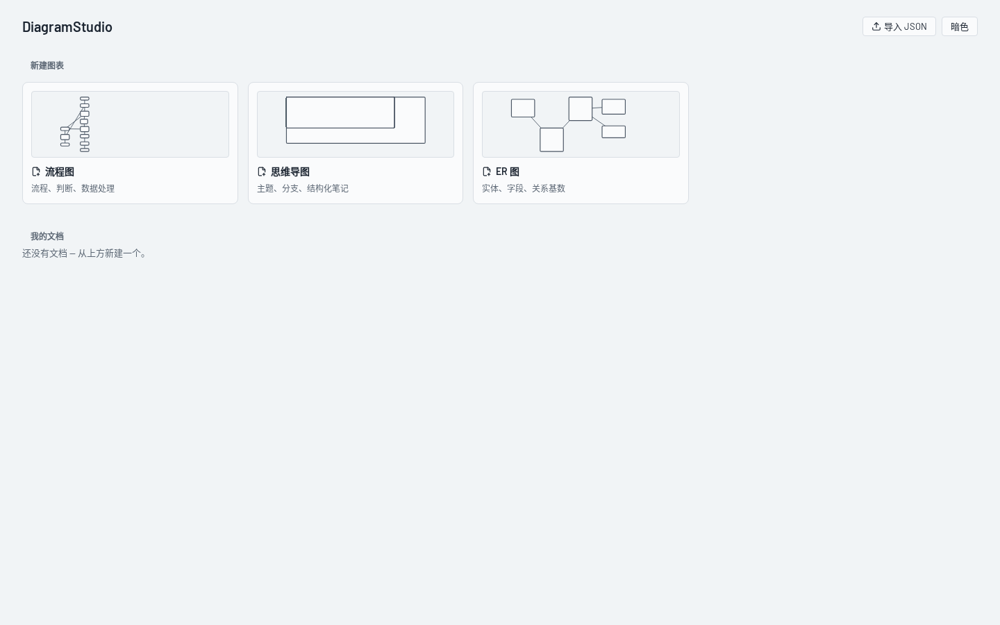
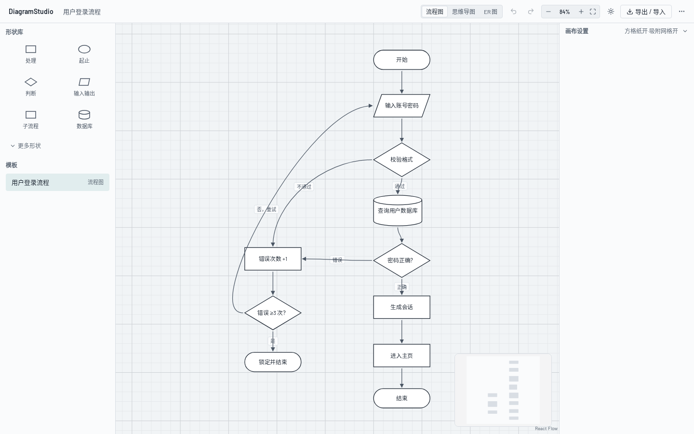
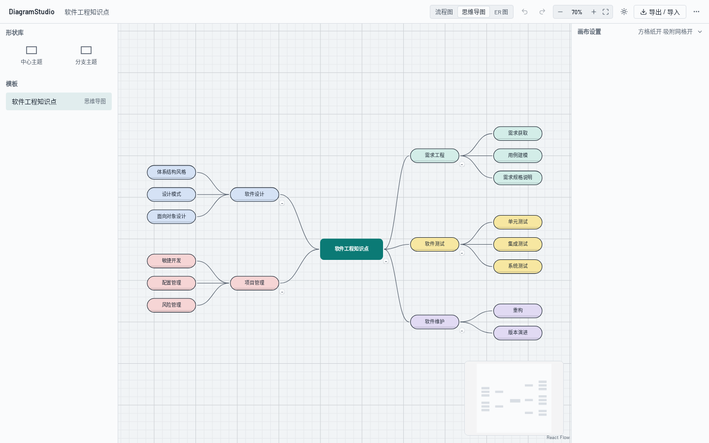
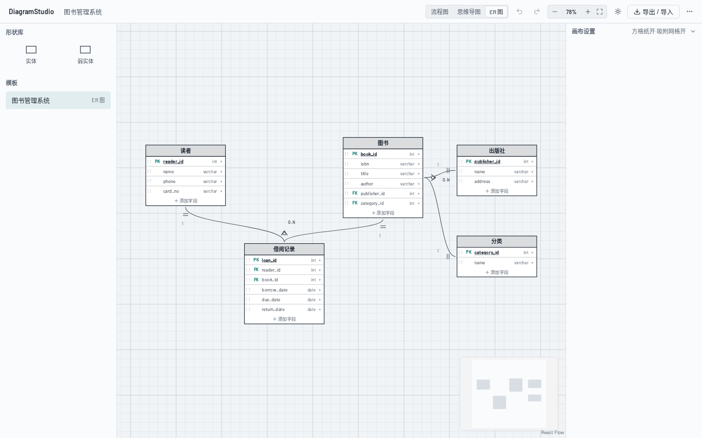
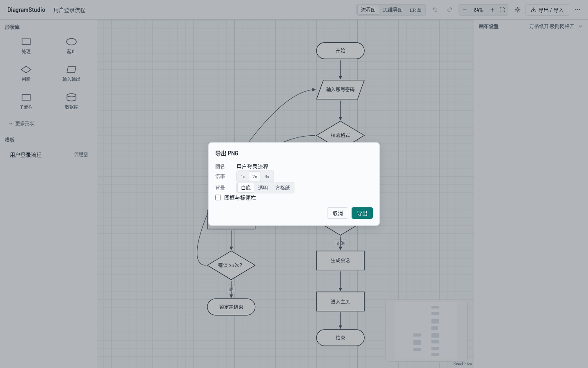
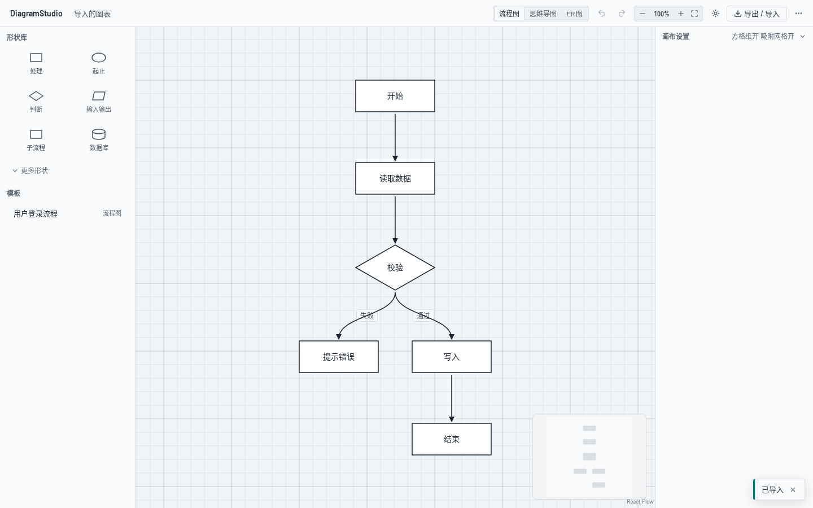
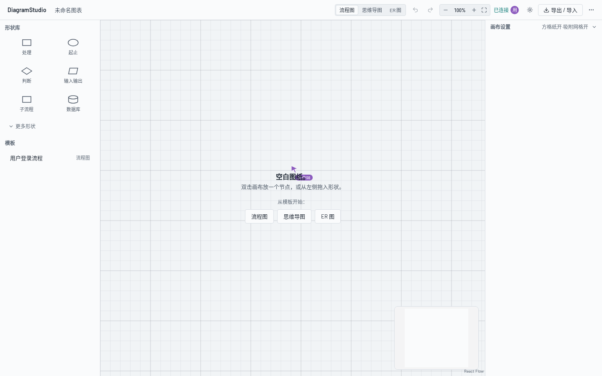
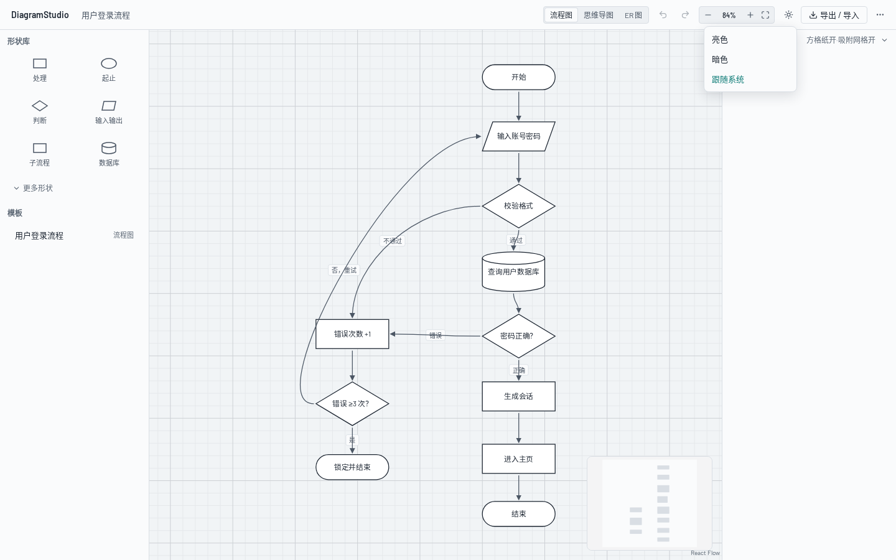

# DiagramStudio 用户手册

> 本文档对应课程交付物清单第 5 项。界面文案以 `src/i18n/zh.ts`、操作口径以 `docs/SPEC.md` §5/§6 为准。

## 目录

- [1. 安装与运行](#1-安装与运行)
- [2. 界面导览](#2-界面导览)
- [3. 基本操作](#3-基本操作)
- [4. 快捷键一览](#4-快捷键一览)
- [5. 三种图用法](#5-三种图用法)
- [6. 文档管理](#6-文档管理)
- [7. 导入与导出](#7-导入与导出)
- [8. 协作分享](#8-协作分享)
- [9. 主题与外观](#9-主题与外观)
- [10. 常见问题](#10-常见问题)

## 1. 安装与运行

要求：Node 20+、pnpm 10+（`packageManager` 已锁定 `pnpm@10.34.6`，可用 `corepack enable` 自动对齐）。

```bash
pnpm install        # 装依赖（装完即完全离线可用）
pnpm dev            # 启动编辑器 → http://localhost:5173
pnpm dev:collab     # 需要协作时：同时启动协作服务 ws://127.0.0.1:1234 与前端
```

其他脚本：`pnpm build`（构建 dist）、`pnpm preview`（预览构建）、`pnpm test`（单测）、`pnpm test:coverage`（覆盖率）、`pnpm e2e`（Playwright）、`pnpm lint` / `pnpm typecheck` / `pnpm format`。

> 打开浏览器窗口宽度需 ≥1024px，否则整屏提示「请使用更宽的窗口」。

## 2. 界面导览

```text
┌──────────────────────────────────────────────────────────────────┐
│ 顶栏 48px：产品名·文档名 │ 图类型分段 │ 撤销·重做·缩放·自动布局 │ 导出·分享·主题 │
├──────────┬───────────────────────────────────────────┬───────────┤
│ 左侧      │                                           │ 右侧       │
│ 形状库    │              方格纸画布                    │ 检查器     │
│ 240px    │   （平移/缩放/框选/连线/对齐参考线/小地图）   │ 280px     │
│ 可折叠    │                                           │ 可折叠     │
└──────────┴───────────────────────────────────────────┴───────────┘
```

- **顶栏**：左侧产品名与可编辑文档名；中间图类型切换（流程图/思维导图/ER 图）、撤销（悬停显示「撤销：×××」）、重做、缩放比例、自动布局；右侧导出、分享（协作）、主题切换。
- **左侧形状库**：当前图类型的形状列表，拖到画布创建节点。
- **右侧检查器**：随选中切换——未选中=画布设置（网格/吸附/小地图）；选中节点=文字/填充/线条/尺寸位置；选中连线=路由/箭头/虚线/颜色（ER 另有基数）；多选=对齐与分布。
- **首页**：文档卡片网格（缩略图为模型直绘的小 SVG），支持新建（空白或模板）、重命名、创建副本、删除（带确认）。



## 3. 基本操作

### 画布与视图

| 操作 | 方式 |
| --- | --- |
| 平移 | 按住空格拖动 / 鼠标中键拖动 / 触控板双指 / H 切抓手工具 |
| 缩放 | Ctrl/Cmd+滚轮；顶栏 +/-；Ctrl/Cmd+0 适应画面（范围 10%–400%） |
| 网格 | 检查器「画布设置」开关方格纸（细格 24px，每 5 格粗线）与吸附（步长 12px，默认开） |
| 小地图 | 检查器开关 |

### 选择与编辑

| 操作 | 方式 |
| --- | --- |
| 选择 | 单击；Shift+单击多选；空白处拖框选 |
| 移动 | 拖动（显示对齐参考线并吸附到其他节点边缘/中心）；方向键 1px、Shift+方向键 10px |
| 缩放节点 | 八方向白色方形夹点拖动（有最小尺寸） |
| 编辑文字 | 双击或 Enter 进入；Shift+Enter 换行；Esc 取消；点空白提交 |
| 剪贴板 | Ctrl+C/X/V：粘贴偏移 24px 且保留所选节点间的连线；Ctrl+D 创建副本；Delete 删除 |
| 叠放 | 右键或 `[`/`]` 快捷键：置于顶层/底层 |
| 对齐/分布 | 多选后检查器或右键菜单：左/中/右/上/中/下对齐；横向/纵向等距分布（≥3 个） |
| 右键菜单 | 菜单项随选中对象变化（节点/连线/空白画布各不同） |

### 连线

| 操作 | 方式 |
| --- | --- |
| 创建 | 悬停节点出现四个连接点（8px 圆点），从任一点拖出，落到目标节点 |
| 落空新建 | 拖到空白松手 → 弹出形状菜单 → 新建节点并自动连好 |
| 改样式 | 选中连线后检查器改：路由（直线/折线/曲线）、起止箭头、虚线、颜色 |
| 标签 | 双击连线加标签 |
| 重连 | 拖动连线端点到别的节点/连接点 |

### 撤销与重做

- Ctrl+Z 撤销、Ctrl+Shift+Z（或 Ctrl+Y）重做；顶栏按钮悬停显示将撤销的操作名（如「撤销：移动 3 个元素」）。
- 拖动一次=一条历史（过程态不入栈）；连续打字 600ms 内合并为一条；历史上限 200 条。
- 自动布局、粘贴、导入各自是一条命令，可整体撤销。

## 4. 快捷键一览

Mac 上 Ctrl 对应 Cmd。

| 键 | 功能 | 键 | 功能 |
| --- | --- | --- | --- |
| V | 选择工具 | Delete | 删除所选 |
| H | 抓手工具 | `[` / `]` | 置底/置顶 |
| Ctrl+A | 全选 | Ctrl+0 | 适应画面 |
| Ctrl+C / X / V | 复制/剪切/粘贴 | Ctrl+ + / − | 缩放 |
| Ctrl+D | 创建副本 | Shift+L | 自动布局 |
| Ctrl+Z | 撤销 | ? | 快捷键列表 |
| Ctrl+Shift+Z / Ctrl+Y | 重做 | Esc | 取消选择/取消文字编辑 |
| 方向键 | 微调 1px（Shift=10px） | Enter | 进入文字编辑 |
| Tab（思维导图） | 加子主题 | Enter（思维导图） | 加同级主题 |

## 5. 三种图用法

### 流程图

- 形状：起止（含双圈变体）、处理、判断、输入输出、子流程、数据库、文档、连接符、便签，全部 SVG。
- 自动布局用 dagre（TB/LR）；支持 Mermaid 导入导出（见 §7）。



### 思维导图

- 从「中心主题」出发：**Tab** 加子主题、**Enter** 加同级主题、**Delete** 删子树。
- 节点右侧圆点折叠/展开子树；每次变动自动左右交替布局；分支自动配色。
- 把一个节点拖到另一节点上可改父级（不允许拖进自己的子树形成环）。



### ER 图

- 实体是表格节点：表头=实体名，行=字段（PK/FK 标记、名称、类型）。
- 行内直接改字段名/类型，「＋ 添加字段」「×」增删字段，可拖动排序；弱实体为虚线外框变体。
- 新建实体/弱实体默认名「实体」/「弱实体」，双击表头改名。
- 关系连线两端在检查器选基数（1、0..1、N、0..N），绘制为鸟脚符号或文字标注。



## 6. 文档管理

- **自动保存**：编辑即存 localStorage（防抖 500ms），顶栏显示「已自动保存 HH:MM」；Ctrl+S 立即保存。
- **新建**：首页可选空白文档或模板——内置模板：流程图「用户登录流程」、思维导图「软件工程知识点」、ER 图「图书管理系统」。
- **重命名/副本/删除**：卡片菜单操作，删除需确认。
- 空画布提示：「空白图纸。双击画布放一个节点，或从左侧拖入形状。」并附模板入口。

## 7. 导入与导出

| 方向 | 格式 | 说明 |
| --- | --- | --- |
| 导出 | JSON | `标题.json`，完整文档，可再导入 |
| 导出 | PNG | 倍率 1x/2x/3x；背景白底/透明/方格纸 |
| 导出 | SVG | 可选「图框与标题栏」：外边框+右下角工程标题栏（图名/作者/日期/版本/比例） |
| 导出 | Mermaid | `标题.mmd`，流程图子集 |
| 导入 | JSON | zod 校验；失败给出具体中文原因（如「字段 nodes.n1.size.w 应为数字」）；悬空连线报「连线的起点不存在」 |
| 导入 | Mermaid | 选择 `.mmd`/文本文件导入，dagre 自动摆位；不认识的行跳过，完成后提示跳过了几行 |





Mermaid 子集：`graph/flowchart` + TD/TB/LR/RL/BT；节点 `A[矩形]`、`A(圆角)`、`A{判断}`、`A([起止])`、`A[(数据库)]`、`A[/输入输出/]`、`A[[子流程]]`、`A((连接符))`；连线 `-->`、`---`、`-.->`、`==>`、`<--`、`<-->`；标签 `-->|文字|` 与 `-- 文字 -->`；链式 `A --> B --> C`。

## 8. 协作分享

1. 先 `pnpm dev:collab` 启动协作服务（默认 ws://127.0.0.1:1234，可用 `VITE_COLLAB_WS` 覆盖）。
2. 顶栏点「分享」→ 复制含 `?room=xxx` 的链接发给同伴。
3. 同伴打开链接即自动进房：双方文档实时同步，可看到对方的彩色光标与昵称（如「用户42」），顶栏显示在线头像。
4. 再点「离开协作」或关掉服务即可回到单机模式——协作失败/关闭时全部编辑功能不受影响。

限制：房间存内存无鉴权；协作中撤销不进入对方历史；昵称自动生成不可改。



## 9. 主题与外观

- 亮色「描图纸」/暗色「蓝图」两套设计令牌，默认跟随系统；顶栏可手动切换并记住（`localStorage: ds:theme`）。
- 节点 7 色：白、描图灰、青、蓝、荧光黄、粉、紫，每色有亮/暗两版——同一份文档切主题自动换色。
- 字体：界面 Barlow、数字 Barlow Semi Condensed（tabular-nums）、中文系统字体；全部本地打包，离线可用。



## 10. 常见问题

**Q：断网还能用吗？**
A：可以。装完依赖后所有资源本地化，文档在浏览器 localStorage；只有协作需要本机服务。

**Q：文档存在哪？会丢吗？**
A：localStorage（键 `ds.docs.v1` + `ds.docIndex.v1`）。清浏览器数据会丢——重要文档请「导出 JSON」备份。

**Q：导入 JSON 报错怎么看？**
A：错误信息是中文且带字段路径，例如「字段 nodes.n3.style.strokeWidth 应为数字」「连线的终点 n9 不存在」，按提示修正文件即可。

**Q：Mermaid 为什么提示「跳过 N 行」？**
A：解析器只支持子集（见 §7），注释与不识别的语句会被跳过；其余内容照常导入。

**Q：撤销怎么只退一步？**
A：拖动/打字的过程态不记历史，一步=一条命令；600ms 内的连续打字合并为一条。历史上限 200 条。

**Q：协作时对方删了我正在改的元素？**
A：远端合并不进本地历史；撤销时若目标元素已被删除，该补丁自动跳过，其他部分正常回退。

**Q：窗口太窄为什么全白屏一句话？**
A：桌面优先设计，<1024px 不渲染错乱界面，只显示「请使用更宽的窗口」。
